<div align="center">



# 👋 Hey, I'm Ibrahim

[](https://git.io/typing-svg)

</div>

---

## 🧠 About me

```python
class Ibrahim:
    role    = "Computer Scientist"
    focus   = ["Problem solving", "Building apps", "Shipping fast"]
    mindset = "Run toward the problem, not away from the dinosaur"
    status  = "Experimenting 🦖"
```

## 🛠️ What I do

- 🧩 **Problem solving**: breaking big, scary problems into small, fixable ones
- 💻 **App development**: web & backend, from idea to deployed
- 🚀 **Entrepreneurship**: building brands and products from scratch

## 🎮 This is my playground

Experiments, half-finished ideas, and things that break in interesting ways.
Some of it runs. Some of it chases me.

## 📫 Say hi

[](https://github.com/HimBono)

<div align="center">

`while (alive) { code(); if (dinosaur) run(); }`

</div>
